# ReviewKit

ReviewKit reviews **one DOCX**. That walk is the review. It opens the file
and stays on it: it does not review an abstract copy and write a different
file only at the end. A side effect on that same file may add a comment,
update a comment, delete a comment, or change the text as a Word tracked
change. Many comments can sit on one sentence because a later stay adds
another while earlier ones stay.

Docxtor is Word. ReviewKit only supplies the rhythm. If the decision is to
change a sentence, it is a tracked replace. If the decision is to delete, it
is a tracked deletion. If the decision is to add a sentence inside an
akapit, it is a tracked insertion. Comments stay Word comments.

## The walk

Order, always:

1. **zdanie** — each sentence. On a sentence, stay (iterate this same
   sentence again) or go (the next sentence).
2. **akapit** — after every sentence is done, the same stay-or-go loop over
   each paragraph.
3. **rozdział** — then the same loop over each chapter (a section cut of
   the document).
4. **całość** — then all original-text stories, walked *n* times, with the same
   stay-or-go loop on each walk.

```mermaid
flowchart TD
  start["one DOCX"] --> z1["zdanie 1"]

  z1 --> z1q{"stay or go?"}
  z1q -->|stay: comment or text on this DOCX| z1
  z1q -->|go| z2["zdanie 2"]

  z2 --> z2q{"stay or go?"}
  z2q -->|stay: comment or text on this DOCX| z2
  z2q -->|go| zMore["zdanie …"]

  zMore --> zMoreq{"stay or go?"}
  zMoreq -->|stay: comment or text on this DOCX| zMore
  zMoreq -->|go: every zdanie done| a1["akapit 1"]

  a1 --> a1q{"stay or go?"}
  a1q -->|stay: comment or text on this DOCX| a1
  a1q -->|go| a2["akapit 2"]

  a2 --> a2q{"stay or go?"}
  a2q -->|stay: comment or text on this DOCX| a2
  a2q -->|go| aMore["akapit …"]

  aMore --> aMoreq{"stay or go?"}
  aMoreq -->|stay: comment or text on this DOCX| aMore
  aMoreq -->|go: every akapit done| r1["rozdział 1"]

  r1 --> r1q{"stay or go?"}
  r1q -->|stay: comment or text on this DOCX| r1
  r1q -->|go| r2["rozdział 2"]

  r2 --> r2q{"stay or go?"}
  r2q -->|stay: comment or text on this DOCX| r2
  r2q -->|go| rMore["rozdział …"]

  rMore --> rMoreq{"stay or go?"}
  rMoreq -->|stay: comment or text on this DOCX| rMore
  rMoreq -->|go: every rozdział done| c["całość"]

  c --> cq{"stay or go?"}
  cq -->|stay: walk całość again, n times| c
  cq -->|go: done, same DOCX| done["same DOCX"]
```



```python
from reviewkit import (
    AKAPIT,
    CALOSC,
    ROZDZIAL,
    StayOrGo,
    ZDANIE,
    review_docx,
)

result = review_docx(path, reviewer)
# reviewer.decide(unit, docx) -> StayOrGo.STAY or StayOrGo.GO
# unit.level is zdanie, akapit, rozdział, or całość
# docx.add_comment / update_comment / delete_comment write Word comments
# docx.replace_text / delete_text / insert_text write tracked changes
```

Stay count on one unit is however many times the reviewer stays. Go at the
end leaves that same file.

## Physical comment regions

The walk keeps its semantic text. Every heading participates as its own paragraph
and sentences, while its chapter includes the heading text once. Body text,
tables, headers, footers, user footnotes, endnotes and text boxes participate at
every level. Native comment bodies remain context. Mechanical note separators
are excluded by Docxtor's physical inventory.

`ReviewUnit.regions` contains one `ReviewRegion(story_id, spans)` per original
story. Each span has an exact physical locator, offsets and raw source text.
`document_sha256` binds all regions to the current DOCX snapshot. The existing
`physical_spans` field contains spans only when the unit has one story. A
multi-story scope never pretends to be one cross-story Word range.

Use the live review operation to comment on a scope:

```python
comment_ids = docx.add_review_comment(unit, "Review remark.")
```

Docxtor validates every source-bound region before adopting the complete
mutation. One story produces one native comment. A multi-story scope produces
one native comment per region. The comments share a `region_set_id` and
`region_set_size` persisted inside DOCX. `DocxComment` exposes those fields so a
consumer can treat the native set as one review instruction. No prose prefix
or external feedback file carries that relationship.

For a validated native bridge between a logical scope and its visible Word
comment, `DocxComment.user_note_text` contains the canonical reviewer remark.
`DocxComment.text` retains the actual full Word text, including its generated
link label. Plain native comments have no separate `user_note_text`. Consumers
use the typed value directly and do not strip labels from comment prose.

The lower-level `add_comment_region(physical_spans=...,
document_sha256=..., text=...)` remains a single-story primitive. Consumers must
not flatten several `ReviewRegion` values into it. Docxtor maps revised effective
text to physical raw origins, preserving the original tracked revisions.
Incomplete geometry raises instead of guessing an anchor from matching text.

Each level captures its ordered source scopes once. The next STAY reloads the
same captured scope's current text, comments and proven geometry. Native tracked
edits carry a source-bound operation receipt chain on the live Docxtor handle.
The walk maps that captured scope through the chain and materializes effective
text from Docxtor's exact source origins. A replacement may produce two sentences
inside the same scope. A complete deletion leaves an empty effective scope.
Both still receive the next callback with the same node ID until explicit GO.

GO advances to the next captured scope. Removing a sentence terminator cannot
silently skip the following original sentence when the current text now parses
as one sentence. A missing physical story or unproved mutation interrupts the
walk. No text matching or semantic-offset guess selects a replacement scope.
Each level validates its represented
paragraph locators against the original-text physical inventory. Successful
`DocxReview.coverage` is `ReviewCoverage.COMPLETE`.

An optional synchronous observer receives typed events:

```python
result = review_docx(path, reviewer, observer=record_event)
```

`ReviewEvent.kind` is `entered`, `stayed`, `advanced`, `interrupted` or `completed`.
Events carry a monotonic sequence, level, node ID, stay index, before/after
snapshot hashes and newly created native comment IDs. They carry no document or
comment text. Exceptions remain exceptions after `interrupted` is emitted.
The observer is diagnostic. DOCX remains the review state.

Existing `DocxComment.start_offset` and `end_offset` describe a proven
single-paragraph anchor, including a point such as `(0, 0)`. A cross-paragraph
comment has `physical_spans` and `end_locator`, with both scalar offsets left
unset. Missing, duplicated, reversed or unsupported markers retain incomplete
`geometry_coverage` and diagnostics; ReviewKit does not guess an anchor by
searching for its text. `read_comments(path, strict=True)` propagates read
failures for consumers that must distinguish failure from no comments. The
legacy tolerant default remains available; the live walk always propagates
projection failures.

## Install and run

```bash
uv sync
uv run reviewkit input.docx --reviewer my_reviewers:make_reviewer
```

Requires Python >= 3.13. Physical DOCX work is Docxtor.

## Contributors

- [mikolaj92](https://github.com/mikolaj92)
- [PSyron](https://github.com/PSyron)

## License

ReviewKit is released under the MIT License. See [LICENSE](LICENSE).
